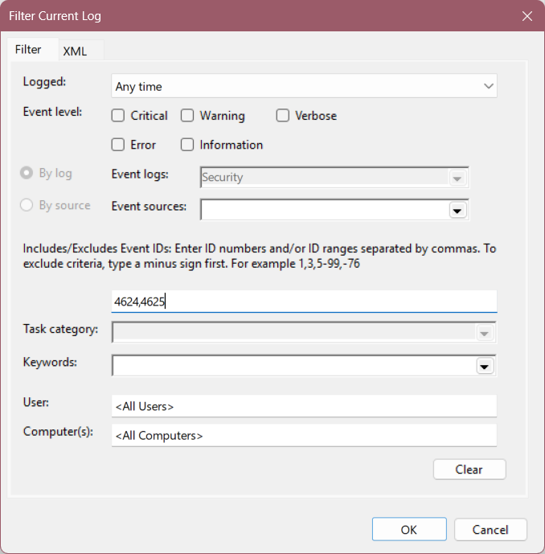
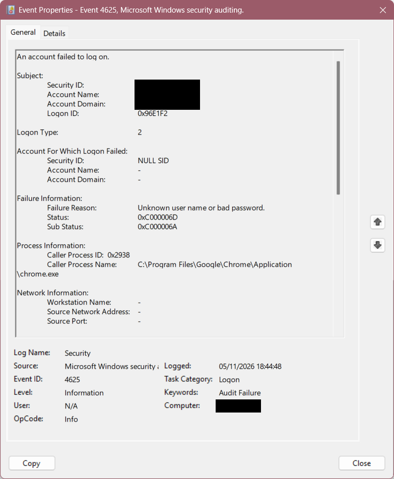
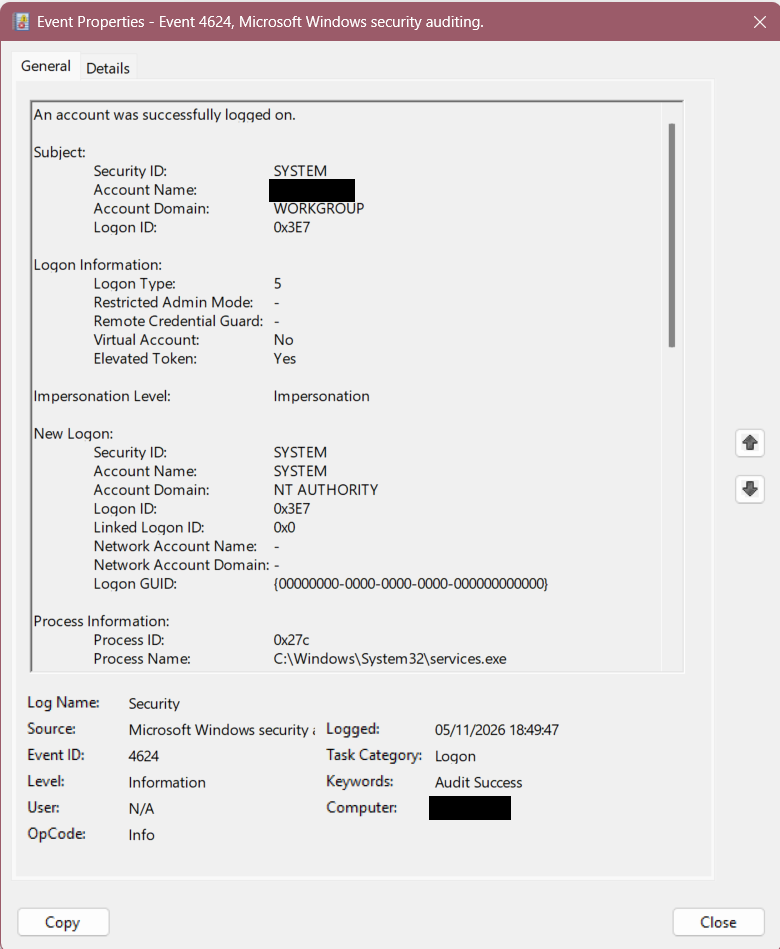
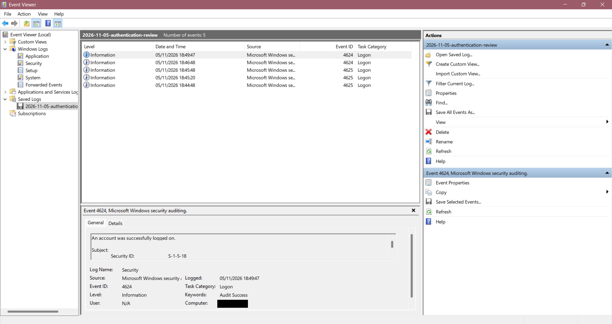

# Windows authentication event investigation

**Author:** Shabbir Bepary  
**Review performed:** 6 November 2026  
**Scope:** Existing Security events on my own Windows 11 PC. This is a learning investigation, not a simulated attack or an employer incident.

## Question and outcome

Did three failed authentication events followed by two successful logons demonstrate a successful retry?

**No relationship was established.** The failures involved Chrome and logon type 2. The two successes involved SYSTEM, services.exe and logon type 5. Their order in time alone does not establish that they belong to the same activity. The original cause of the failures remains unconfirmed.

## Environment and work completed

Windows 11, 16 GB RAM; Windows Event Viewer, Windows Logs > Security.

1. Filtered the Security log for Event IDs 4624 and 4625.
2. Examined failure information, logon type, account context, caller process and network fields.
3. Compared three failures with two nearby successes.
4. Exported the five selected events to an EVTX file.
5. Reopened that file and verified that it contained five events.
6. Prepared cropped screenshots with solid redaction blocks over personal usernames and computer names. Originals and the raw EVTX are kept private.

No controlled logon test, SIEM deployment, malware scan or remediation was performed in this exercise.

## Timeline

Date: **5 November 2026**. Times below are displayed by Event Viewer; the device timezone and clock accuracy were not independently verified.

| Displayed time | Event ID | Logon type | Recorded process | Observation |
| --- | --- | --- | --- | --- |
| 18:44:48 | 4625 | 2 | chrome.exe | Authentication failed; status 0xC000006D, substatus 0xC000006A |
| 18:45:20 | 4625 | 2 | chrome.exe | Same displayed failure codes |
| 18:45:48 | 4625 | 2 | chrome.exe | Same displayed failure codes |
| 18:46:48 | 4624 | 5 | services.exe | Successful SYSTEM service logon |
| 18:49:47 | 4624 | 5 | services.exe | Successful SYSTEM service logon |

The public images show one representative failure, one representative success, and the five-event export. The other event details were reviewed during the exercise but are not individually illustrated here.

## Evidence

### 1. Filter

The filter includes both success and failure events; its total is not a count of failed attempts.

### 2. Failed authentication

The event records the caller path as `C:\Program Files\Google\Chrome\Application\chrome.exe`, logon type 2, and the failure message “Unknown user name or bad password.” The target account name and domain are shown as dashes and the target SID as NULL SID. Network source fields are also dashes.

The subject identifies the context requesting the logon; it must not automatically be treated as the attempted target account. A missing source IP is missing evidence, not proof that all possible remote involvement is excluded.

### 3. Successful service-logon comparison

The successful event has logon type 5, a new logon for SYSTEM under NT AUTHORITY, and process `C:\Windows\System32\services.exe`. These fields differ from the failed authentication events.

Microsoft documents type 2 as interactive and type 5 as service. Event 4624 records a created logon session; it does not necessarily represent a person signing in at the desktop. See the references below.

### 4. Verified export

Reopening the export confirmed that the selected five records were readable. This is an export check, not a forensic chain-of-custody claim. No original-file hash was recorded during collection.

## Assessment and limits

- Confirmed: three failed authentications were recorded with Chrome as the caller; two nearby successes were SYSTEM service logons.
- Possible explanation: a local Windows authentication request associated with Chrome. The exact browser action or prompt was not captured, so this remains a hypothesis.
- Not established: who supplied credentials, whether someone mistyped a password, whether the successes resolved the failures, or whether malicious activity occurred.
- The process path alone does not verify executable integrity.
- This small review does not prove that the entire device was safe or compromised.

**Disposition:** learning review documented; root cause unresolved. I would gather further context before classifying this as a security incident or closing it as benign.

## Follow-up plan — not yet performed

Check what activity was occurring at those times; review a wider time window; compare account, logon type, process and available correlation fields. If process-creation logs exist, use them with timestamps to investigate the historical process IDs. Avoid assuming that a current process with the same PID is the historical one.

Escalation would be appropriate if further evidence showed unexplained repeated attempts, an unexpected executable, suspicious remote sources or a related unauthorised successful logon. In an organisation I would follow its triage and escalation procedure.

## What I learned

My first thought was that someone had entered the wrong credentials and then succeeded. Comparing logon types and processes showed why that conclusion was premature. I learned to separate observations from explanations, preserve evidence and record uncertainty clearly.

## References

- [Microsoft: Event 4625 and its fields](https://learn.microsoft.com/en-us/previous-versions/windows/it-pro/windows-10/security/threat-protection/auditing/event-4625)
- [Microsoft: Event 4624 and logon types](https://learn.microsoft.com/en-us/previous-versions/windows/it-pro/windows-10/security/threat-protection/auditing/event-4624)

AI assisted with explanations, documentation and redaction preparation. I performed the Event Viewer review and export on my own device. The screenshots are real evidence; text outside the redaction blocks has not been regenerated.
